<picture>
  <source media="(max-width: 600px) and (prefers-reduced-motion: reduce)" srcset="./assets/lab/hero-mobile-still.svg" />
  <source media="(max-width: 600px)" srcset="./assets/lab/hero-mobile.svg" />
  <source media="(prefers-reduced-motion: reduce)" srcset="./assets/lab/hero-still.svg" />
  
</picture>

  <a href="#selected-builds">GÓC CHẾ TẠO</a> &nbsp; / &nbsp;
  <a href="#build-rhythm">NHỊP XÂY DỰNG</a> &nbsp; / &nbsp;
  <a href="#behind-the-scenes">SAU MÀN HÌNH</a>

Mình là **Phùng Hữu Luân**. Mình học bằng cách xây dựng: từ một ứng dụng ghi chú giúp giữ lại ý tưởng, đến thử nghiệm đưa C++ vào trình duyệt. Gần đây, mình còn tò mò về những gì **AI có thể làm cùng âm nhạc**.

## Selected builds

Ba hướng khám phá, mỗi hướng một chút cá tính. **Bấm vào từng thẻ để xem dự án.**

<a href="https://github.com/luan0217091310-gif/note-app-final">
  <picture>
    <source media="(max-width: 600px) and (prefers-reduced-motion: reduce)" srcset="./assets/lab/note-mobile-still.svg" />
    <source media="(max-width: 600px)" srcset="./assets/lab/note-mobile.svg" />
    <source media="(prefers-reduced-motion: reduce)" srcset="./assets/lab/note-still.svg" />
    
  </picture>
</a>

  <a href="https://github.com/luan0217091310-gif/WebAssembly"><picture><source media="(prefers-reduced-motion: reduce)" srcset="./assets/lab/wasm-still.svg" /></picture></a>
  <a href="https://github.com/luan0217091310-gif/vocapiano-ai-studio"><picture><source media="(prefers-reduced-motion: reduce)" srcset="./assets/lab/music-still.svg" /></picture></a>

[Khám phá tất cả repository ↗](https://github.com/luan0217091310-gif?tab=repositories)

## Build rhythm

Lịch đóng góp của mình, viết lại thành một bản nhạc nhỏ. **Mỗi cột là một tuần**, chiều cao thể hiện số đóng góp trên lịch công khai; vạch sáng chạy qua như kim phát nhạc.

<picture>
  <source media="(max-width: 600px) and (prefers-reduced-motion: reduce)" srcset="./assets/lab/pulse-mobile-still.svg" />
  <source media="(max-width: 600px)" srcset="./assets/lab/pulse-mobile.svg" />
  <source media="(prefers-reduced-motion: reduce)" srcset="./assets/lab/pulse-still.svg" />
  
</picture>

## Behind the scenes

<b>🧰 Mở ngăn kéo công nghệ</b>

| Trong ngăn kéo | Mình dùng để làm gì? |
| --- | --- |
| **PHP · Laravel · MySQL** | Xây dựng ứng dụng web, quản lý dữ liệu và cộng tác thời gian thực. |
| **JavaScript · HTML · CSS · Bootstrap** | Làm giao diện và các tương tác trên trình duyệt. |
| **C++ · WebAssembly** | Thử nghiệm xử lý ảnh và so sánh hiệu năng thực thi. |

<b>🎹 Một hướng khám phá khác: code × âm nhạc</b>

**VocaPiano AI** bắt đầu từ một câu hỏi: liệu một bản thu có thể trở thành hướng dẫn học hát và piano trực quan?

Mình đang tìm hiểu bài toán tách âm thanh, nhận diện cao độ và chuyển nốt nhạc thành hình ảnh. Đây là **ý tưởng nghiên cứu đang được đề xuất**; tài liệu và hướng triển khai nằm trong [repository VocaPiano AI](https://github.com/luan0217091310-gif/vocapiano-ai-studio).

 

<a href="https://github.com/luan0217091310-gif?tab=repositories">
  <picture><source media="(prefers-reduced-motion: reduce)" srcset="./assets/lab/footer-still.svg" /></picture>
</a>
