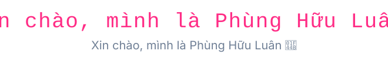

  

Xin chào! Mình là **Phùng Hữu Luân**. Mình thích xây dựng ứng dụng web, khám phá công nghệ và học hỏi qua những dự án thực tế. Các dự án của mình trải dài từ ứng dụng ghi chú cộng tác đến xử lý ảnh với WebAssembly; mình cũng đang tìm hiểu hướng ứng dụng AI trong học nhạc.

## Về mình

- 💻 Xây dựng ứng dụng web với **PHP, Laravel, JavaScript và MySQL**.
- ⚡ Khám phá **C++ / WebAssembly** để xử lý ảnh ngay trên trình duyệt.
- 🎹 Tìm hiểu ý tưởng **VocaPiano AI** — hỗ trợ học thanh nhạc và piano bằng AI.
- 🌱 Học qua từng dự án, cải thiện từng chi tiết và chia sẻ những gì mình làm.
- 💬 Cùng trao đổi tại [GitHub của mình](https://github.com/luan0217091310-gif).

## 🧑‍💻 Công nghệ trong các dự án

  

## 📊 Thống kê GitHub

  
  

## 🚀 Dự án nổi bật

  
  

| Dự án | Nội dung |
| --- | --- |
| [📝 Note App](https://github.com/luan0217091310-gif/note-app-final) | Ứng dụng quản lý ghi chú với Laravel, cộng tác thời gian thực và hỗ trợ ngoại tuyến. |
| [⚡ WebAssembly](https://github.com/luan0217091310-gif/WebAssembly) | Demo xử lý ảnh, so sánh thực thi giữa JavaScript và C++ / WebAssembly. |
| [🎹 VocaPiano AI](https://github.com/luan0217091310-gif/vocapiano-ai-studio) | Đề xuất dự án ứng dụng AI để phân tích ca khúc và hỗ trợ học thanh nhạc, piano. |

---

  Luôn tò mò. Luôn học hỏi. Luôn xây dựng.

